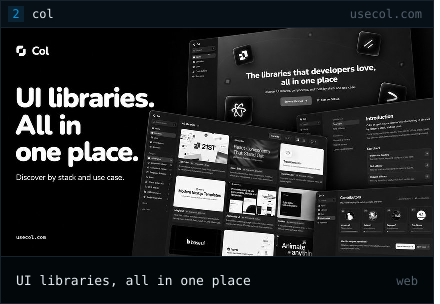
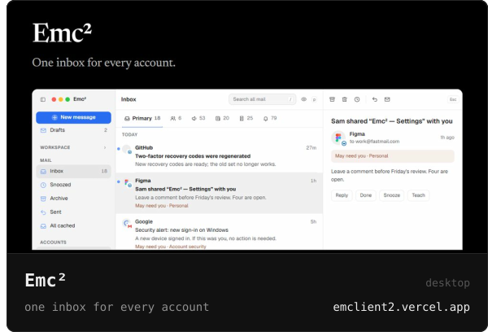
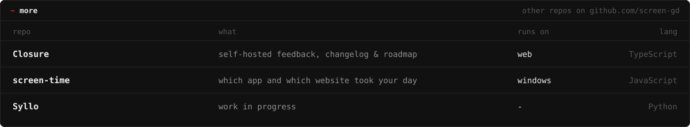

  

  <a href="https://usecol.com">usecol.com</a> ·
  <a href="https://emclient2.vercel.app">emc²</a> ·
  <a href="https://znsnexus.com">znsnexus.com</a> ·
  <a href="https://zaid.us.ci">zaid.us.ci</a> ·
  <a href="https://x.com/screeendev">@screeendev</a>

  

  

